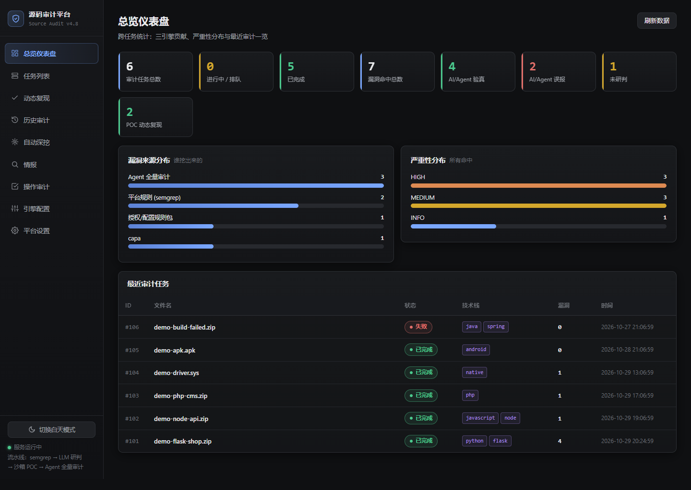
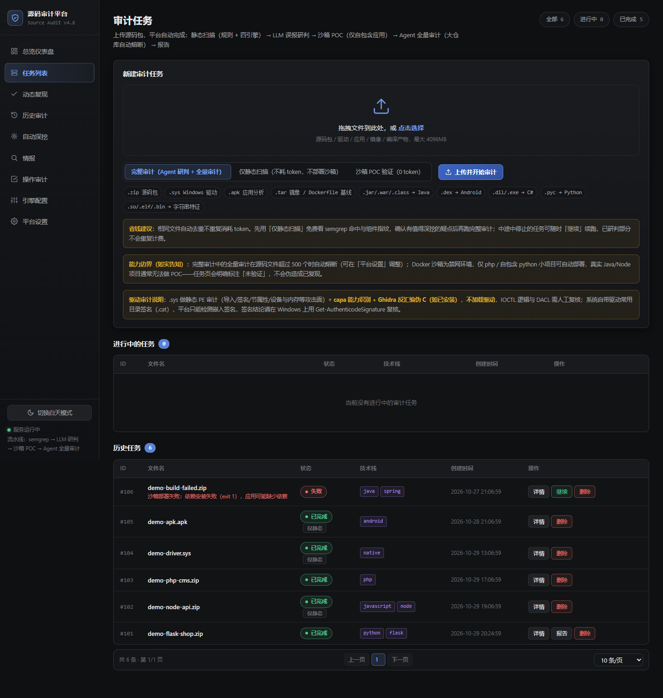
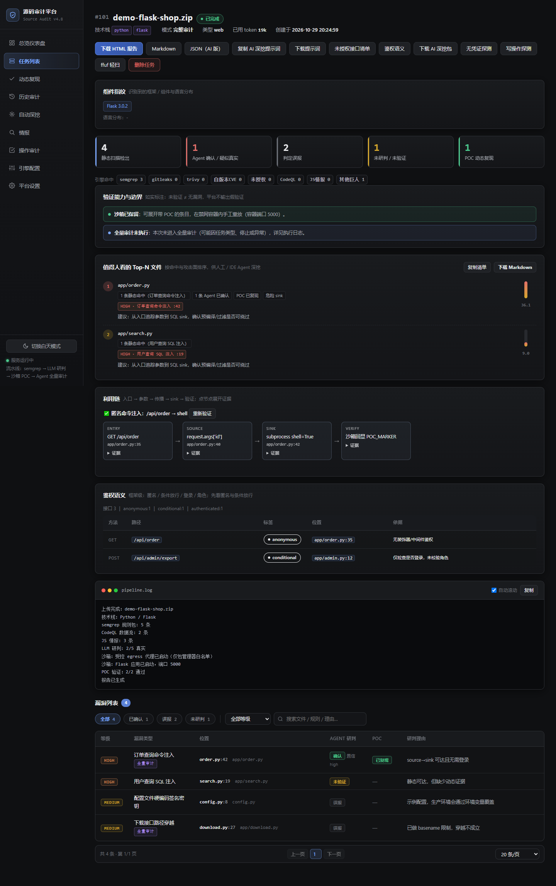
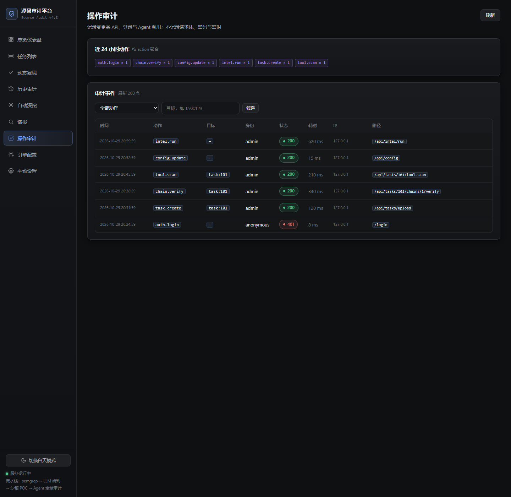
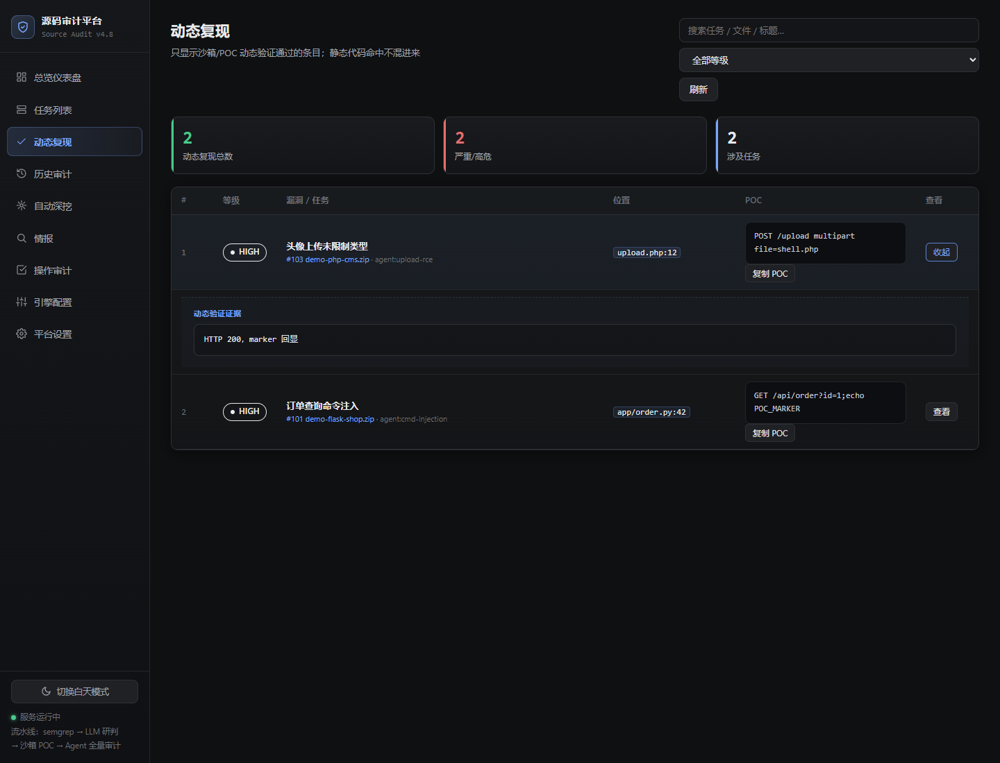
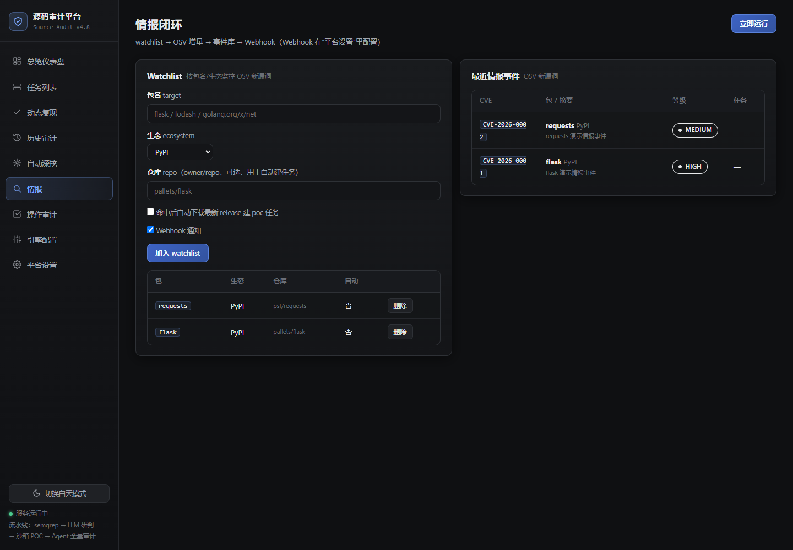
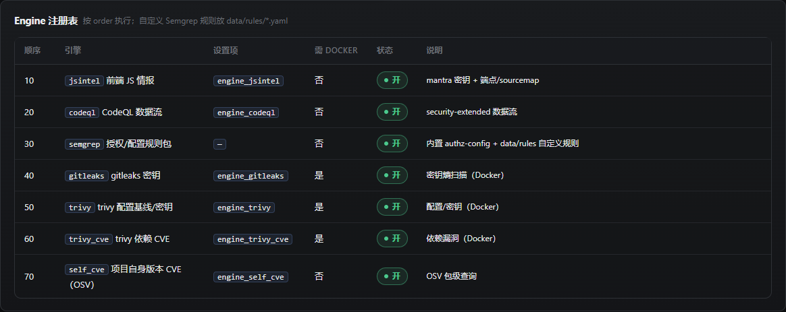
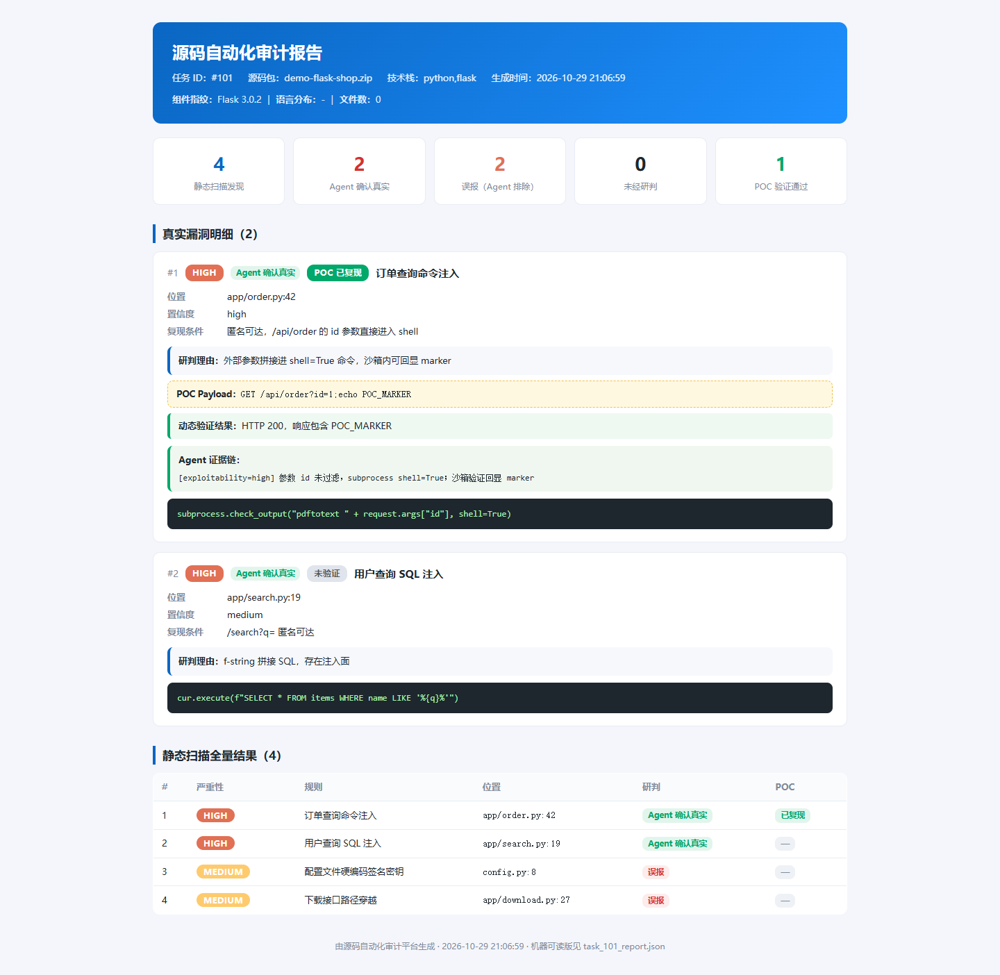

# ISeeCode · 源码自动化审计平台

> 上传源码包 → 多引擎离线扫描 → 候选去重/研判 → 沙箱 POC 验证 → 中文报告
>
> 确定性引擎负责“不漏”，LLM/Agent 负责“研判与表达”，不把静态候选伪装成已复现漏洞。



## 这是什么

ISeeCode 是一个自托管的源码审计平台，面向 SRC/CVE 研究和开源项目审计。它把 semgrep、gitleaks、trivy、CodeQL、JS 情报、OSV 等能力接到同一套任务流水线中，并用 Docker 沙箱尝试复现候选问题。

- **多引擎静态扫描**：semgrep 多语言内置规则（Go/Java/Python/JS/TS/PHP/Ruby/Rust/C/C++/C#/Kotlin/Swift/Dart/Scala/HTML）+ 定向/开源规则包 + gitleaks 密钥 + trivy 配置/依赖 CVE + CodeQL 数据流 + JS 端点/密钥情报 + OSV 自身版本 CVE
- **沙箱 POC 验证**：Python/Node/PHP/Go/Java 项目在受限容器内启动；能验证就写 `poc_verified`，验证不了就如实报 `blocked`，不伪造 0day
- **Agent 深挖（可选）**：兼容 OpenAI 协议的模型可用四阶段 ReAct（triage → exploit → verify → judge）；没有 API key 时纯规则/沙箱流程仍可运行
- **审计与 RBAC**：变更类 API、登录和 Agent 调用写入 `audit_events`；支持 admin/auditor/viewer 三档令牌
- **路由与鉴权清单**：Java 类级 `@RequestMapping`、JS 变量/多行 Express、Django URLconf，统一路径归一化，减少前端文件误报
- **依赖 CVE**：`tools/scan_dependencies.py` 递归解析 Maven `pom.xml`、npm `package.json`、`composer.lock`、`requirements*.txt`，走 OSV querybatch
- **CLI**：`list / status / wait / submit / report / vulns / audit / stats`
- **自定义规则**：把 Semgrep YAML 放进 `data/rules/`，新任务自动加载；Engine 注册表可在 `/engines` 查看
- **工程安全**：沙箱 cap-drop ALL（保留 NET_BIND_SERVICE）、no-new-privileges、只读根、端口只绑 127.0.0.1；依赖阶段走受控 egress 白名单代理，装完不再直连外网
- **自托管**：SQLite WAL + 本地报告，无强制云依赖；LLM 配置可留空

支持输入：`.zip` 源码包、`.sys` Windows 驱动、`.apk`、`.tar` 镜像、Dockerfile，以及 `.jar/.war/.class/.dex/.dll/.exe/.pyc` 等反编译产物。

## 截图

| 总览仪表盘 | 任务列表 |
|---|---|
|  |  |

| 任务详情（Top-N / 利用链 / 鉴权） | 操作审计 |
|---|---|
|  |  |

| 动态复现 | 情报闭环 |
|---|---|
|  |  |

| Engine 注册表 | 审计报告 |
|---|---|
|  |  |

## 快速开始

环境：Linux（Ubuntu 22.04 / Kali 均可）、Python 3.10+、Docker；建议 4C/8G。Windows 可用 WSL2 运行。

```bash
git clone https://github.com/Xudde/ISeeCode.git
cd ISeeCode

python3 -m venv .venv
source .venv/bin/activate
pip install -r requirements.txt

# 必填：服务端 API token（脚本/CLI 用）
export AUTH_TOKEN="$(python3 -c 'import secrets;print(secrets.token_urlsafe(24))')"
# 浏览器登录用；不设置则只能用 /login?token=$AUTH_TOKEN
export AUTH_USER=admin
export AUTH_PASS='换成你的密码'

bash start.sh
```

浏览器打开 `http://127.0.0.1:8000`。首次启动会创建 `data/app.db`；`data/`、`master.key`、上传内容和工作区都不应提交到 Git。

> 如果使用 systemd/supervisor，请把 `AUTH_TOKEN`、`AUTH_USER`、`AUTH_PASS` 放进受保护的环境文件，不要写进仓库。

## 可选引擎

| 引擎 | 依赖 | 说明 |
|---|---|---|
| semgrep | `pip install semgrep` | 内置规则 + `data/rules` 自定义规则 |
| gitleaks | Docker 镜像 `zricethezav/gitleaks` | 首次扫描自动拉取 |
| trivy | Docker 镜像 `aquasec/trivy` | 配置基线/密钥/依赖 CVE |
| CodeQL | `codeql` CLI，默认 `/opt/giants/codeql` | 小仓库数据流；可用 `AUDIT_CODEQL_BIN` 覆盖 |
| JS 情报 | 可选 mantra 二进制 | 无 mantra 时仍做端点/sourcemap 提取 |
| MobSF | 可选容器 | APK 深度静态分析；未配置时仍做原生 Manifest/DEX |
| LLM | OpenAI 兼容接口 | 不配置则跳过 LLM 研判，规则/沙箱流程不受影响 |

## CLI

```bash
export ISEECODE_URL=http://127.0.0.1:8000
export ISEECODE_TOKEN="$AUTH_TOKEN"

python tools/iseecode_cli.py list --limit 20
python tools/iseecode_cli.py submit project.zip --mode static --wait
python tools/iseecode_cli.py status 42 --log 20
python tools/iseecode_cli.py report 42 --format md --out task42.md
python tools/iseecode_cli.py vulns 42 --verified
python tools/iseecode_cli.py audit --limit 20
```

`--mode` 可选 `full`（静态 + 可选 LLM/Agent）、`static`（0 token 静态）、`poc`（沙箱验证，0 token）。

## 自定义规则

```yaml
# data/rules/my-rule.yaml
rules:
  - id: my-danger-call
    languages: [python]
    message: "调用了危险函数"
    severity: WARNING
    pattern: dangerous_func(...)
```

规则会先经过 `semgrep --validate`，无效文件会被跳过并写入任务日志；有效规则与内置规则包一起执行。默认最多加载 50 个文件，可用 `AUDIT_MAX_CUSTOM_RULES` 调整。更多说明见 [docs/CUSTOM_RULES.md](docs/CUSTOM_RULES.md)。

## v4.9 更新（2026-11-01）

- 多语言内置 Semgrep 规则覆盖 16 种语言；PHP 定向规则扩到 13 条。
- 开源规则包：gosec 7 条 + njsscan 21 条（共 28 条），默认 `AUDIT_RULE_PACKS_MODE=test`；配置缺失或哈希不符时 fail-closed，`extended` 预留。项目特有的定向规则请放 `data/rules/`，不随仓库发布。
- 路由/鉴权：Java 类级注解、JS 变量/多行 Express、Django URLconf 提取修复与路径归一化。
- Agent 与任务：动态证据判定、领取/租约状态、跨任务重复行去重。
- UI：P1/P2 修复、统一错误页、lab/沙箱视图、本地字体。
- 边界不变：规则命中仍是候选；`verified` 也不等于 0day。

完整变更见 [RELEASE_NOTES_v4.9.md](RELEASE_NOTES_v4.9.md)。

## 架构

```
上传(zip/sys/apk/tar/dll…)
  → 预处理/反编译 → 技术栈识别
  → semgrep / gitleaks / trivy / CodeQL / JS 情报 / OSV
  → Docker 沙箱 POC（受限网络 + 只读根）
  → 可选 LLM/Agent 研判 → 中文报告（HTML/MD/JSON）
```

技术栈：FastAPI + SQLAlchemy(SQLite WAL) + Jinja2 + Docker SDK + semgrep + OpenAI-compatible LLM。

更多见 [docs/ARCHITECTURE.md](docs/ARCHITECTURE.md)；阶段和边界见 [docs/ROADMAP.md](docs/ROADMAP.md)。

## 目录

```
app/                 后端流水线、引擎、Agent、报告
app/skills/rules/    多语言内置 Semgrep 规则
app/skills/rule_pack_data/  开源规则包（gosec/njsscan 移植）
app/skills/giants_rules/   内置授权/配置规则
app/skills/egress_proxy.py 沙箱依赖阶段白名单代理
data/rules/          自定义 Semgrep 规则（运行时目录）
templates/ static/   Web UI
tools/iseecode_cli.py CLI；tools/scan_dependencies.py 依赖 CVE 递归扫描
docs/                架构、路线、规则说明、截图
```

## 安全与诚实边界

- 沙箱不是“绝对安全”的虚拟机：容器隔离 + cap-drop + 只读根 + egress 白名单降低风险，但不等于能安全运行任意恶意样本。
- `verified` 只代表候选在沙箱内被验证；不代表真实生产环境可利用，也不等于 0day。
- 静态规则会有误报/漏报；LLM 结论需要人工复核；平台不承诺发现所有漏洞。
- 依赖阶段白名单以包管理器域名族为默认；可按 [docs/ARCHITECTURE.md](docs/ARCHITECTURE.md) 调整。工作区在依赖安装阶段仍为可写（Docker bind mount 限制），敏感场景请自行收紧。
- 生产部署请设置强 `AUTH_TOKEN`/`AUTH_PASS`，不要把 `data/`、`master.key`、日志或真实 API key 提交到仓库。

## License

MIT（见 [LICENSE](LICENSE)）；第三方引擎/工具遵循各自许可证。移植规则中 gosec 为 Apache-2.0、njsscan 为 LGPL-3.0（见 [app/skills/rule_pack_data/OPENSOURCE-NOTICE.md](app/skills/rule_pack_data/OPENSOURCE-NOTICE.md)）；Lato/Fira Code 字体为 SIL OFL 1.1（见 [static/fonts/README.md](static/fonts/README.md)）。CodeQL 商用需遵循 GitHub 条款。
